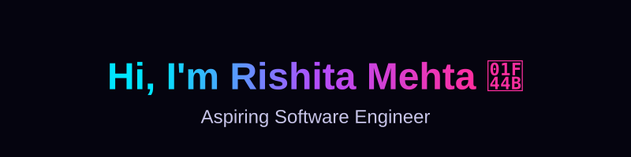

 

<table align="center" width="100%" style="border: none;">
  <tr>
    <td width="50%" valign="top">
      <h2>👋 Hi there, I'm Rishita!</h2>
      <b>🎓 Education:</b> Final Year B.Tech CSE @ VIT Bhopal University (CGPA: 8.83/10) 
      <b>💼 Role:</b> Aspiring Product Manager 
      <b>💡 Interests:</b> Product Strategy, User Research, Fintech and Consumer Tech, AI Products 
      <b>🌱 Learning:</b> Product Analytics, Experimentation, SQL, Generative AI 
      <b>🎯 Open to:</b> Product Management Internships, APM, Business Analyst and Product Ops roles 
       
      <blockquote>
<i>"Find the right problem first, then build the right solution."</i>
</blockquote>
    </td>
    <td width="50%" valign="top">
      <h3>🚀 Specialization</h3>
      
      
      
      
        
      <h3>🏆 Key Achievements</h3>
      
       
      
       
      
       
      
    </td>
  </tr>
</table>

## How I Approach Product

<table width="100%">
<tr>
<td width="20%" valign="top" align="center">

**1. Discover**

Talk to users, read feedback, benchmark competitors

</td>
<td width="20%" valign="top" align="center">

**2. Define**

Turn the problem into clear requirements and a north star metric

</td>
<td width="20%" valign="top" align="center">

**3. Prioritize**

Rank ideas with RICE and cut scope to a realistic first version

</td>
<td width="20%" valign="top" align="center">

**4. Prototype**

Build something clickable so people can react to it early

</td>
<td width="20%" valign="top" align="center">

**5. Measure**

Plan experiments, track metrics and set guardrails

</td>
</tr>
</table>

## Featured Case Studies

Full write-ups, decks and demos live on my <a href="https://rishita-product-portfolio.vercel.app/">portfolio</a>

<table width="100%">
<tr>
<td width="50%" valign="top">

**[Paytm Business Repeat Pay](https://rishita-product-portfolio.vercel.app/case-studies/paytm)**
`Paytm Innovation Challenge 2026 · Payments`

Merchants rarely use Paytm for business payments. Designed a repeat-payment flow where they save a payee, pay again, add a reference and share proof of payment. Set a north star metric with guardrails on duplicate payments, wrong recipients and pending time. Tested on a simulated survey, so real merchant interviews are the next step. An independent concept, not an official Paytm product.

[Case Study](https://rishita-product-portfolio.vercel.app/case-studies/paytm) · [Live Demo](https://paytm-business-repeat-pay.vercel.app/business)

</td>
<td width="50%" valign="top">

**[Spotify Growth Strategy: Mood Mode](https://rishita-product-portfolio.vercel.app/case-studies/spotify)**
`Product Growth · Gen Z Music Discovery`

Found a gap in contextual and social music discovery for Gen Z using the AARRR funnel, Jobs To Be Done and a north star metric. Designed Mood Mode, a feature that suggests music based on how the listener feels, ranked it with RICE and planned an experiment with clear success metrics.

[Case Study](https://rishita-product-portfolio.vercel.app/case-studies/spotify) · [Live Demo](https://rishita-product-portfolio.vercel.app/case-studies/spotify/demo)

</td>
</tr>
<tr>
<td width="50%" valign="top">

**[Vasudha: Digital Livestock Safety](https://rishita-product-portfolio.vercel.app/case-studies/vasudha)**
`SIH 2025 · National Runner-Up among 1200+ teams`

Livestock antibiotic use in India has no reliable digital record, so unsafe milk and meat can reach buyers. Vasudha puts farmers, vets, labs, regulators and buyers on one shared, QR-traceable record, with a rule engine that works out safe drug withdrawal periods. Owned the research and documentation and built the backend and rule engine.

[Case Study](https://rishita-product-portfolio.vercel.app/case-studies/vasudha) · [Live Demo](https://www.vasudha-dahd.app/) · [Code](https://github.com/Mehtarishita/Vasudha)

</td>
<td width="50%" valign="top">

**[Hitwicket Product Challenge](https://rishita-product-portfolio.vercel.app/case-studies/hitwicket)**
`Gaming · User Research`

Three problems: new players struggle to understand the game, social features are thin, and women are underrepresented. Proposed guided onboarding, Hitwicket Spotlight, a social prediction layer around big matches, and trust-first changes for women gamers such as fairer matchmaking and women-focused leagues. Built a clickable prototype of Spotlight. Based on five player interviews and a review of women gamers' feedback.

[Case Study](https://rishita-product-portfolio.vercel.app/case-studies/hitwicket)

</td>
</tr>
<tr>
<td width="50%" valign="top">

**[INKling 2026 × Dot.](https://rishita-product-portfolio.vercel.app/case-studies/dot)**
`Top 10 among 1500+ teams · IIM Ranchi`

Solved six product, strategy and marketing challenges for Dot across retention, community, customer acquisition, school go-to-market, social media and brand. Full decks are in the case study.

[Case Study](https://rishita-product-portfolio.vercel.app/case-studies/dot)

</td>
<td width="50%" valign="top">

**[Vrinda Store Sales and Customer Analytics Dashboard](https://rishita-product-portfolio.vercel.app/case-studies/vrinda-store)**
`Data Analytics · Excel`

Cleaned about 31K transaction records across 21 fields and built an interactive Excel dashboard with PivotTables, PivotCharts and slicers for month, category and channel. It covers sales trends, top states, channels, customer mix and order status. Findings describe this dataset only.

[Case Study](https://rishita-product-portfolio.vercel.app/case-studies/vrinda-store)

</td>
</tr>
</table>

### Also Built

<table width="100%">
<tr>
<td width="50%" valign="top">

**[StyleMeUp](https://github.com/Mehtarishita/StyleMeUp)**
`Work in Progress · AI Fashion Shopping`

A fashion shopping product concept with AI styling and personalized outfit recommendations. Planned user journeys, a staged roadmap and requirements for the AI features, and dropped virtual try-on to keep the first version realistic.

[Live Demo](https://style-me-up.vercel.app/) · [Code](https://github.com/Mehtarishita/StyleMeUp)

</td>
<td width="50%" valign="top">

**[Smart Flow: Traffic Management](https://github.com/Mehtarishita/SmartFlow-Traffic-System)**
`Published Indian Patent`

Computer vision system that detects vehicles across lanes in real time and prioritizes lanes at intersections, with a live dashboard.

[Code](https://github.com/Mehtarishita/SmartFlow-Traffic-System)

</td>
</tr>
<tr>
<td width="50%" valign="top">

**[SamvidhanPath](https://github.com/Mehtarishita/Samvidhan-Path)**
`Full Stack Product · Civic Education`

Constitutional learning platform that makes civic education interactive through quizzes and personalized learning paths. Built and deployed end to end.

[Live Demo](https://samvidhan-path.vercel.app/) · [Code](https://github.com/Mehtarishita/Samvidhan-Path)

</td>
<td width="50%" valign="top">

**Station Guide**
`Smart India Hackathon`

Railway navigation platform built to improve passenger accessibility at stations.

</td>
</tr>
</table>

## Toolkit

 

**Product and Design**
 

**Data and Analytics**
 

**Frameworks**
 
`RICE` · `AARRR Funnel` · `Jobs To Be Done` · `North Star Metric` · `SWOT` · `Go-to-Market`

**Technical Foundation**
 

  

`Data Structures` · `Algorithms` · `DBMS` · `Operating Systems` · `Computer Networks` · `OOP`

## Impact

- **Smart India Hackathon 2025 National Runner-Up**, among 1200+ teams
- **Top 10 at INKling 2026, IIM Ranchi**, among 1500+ teams, solving six business challenges for Dot
- **Published an Indian Patent** for an AI-driven Intelligent Traffic Management System
- Wrote six product and strategy case studies, most with a live demo or prototype
- Ran market and competitor research for early-stage AI startups as a Business Development Intern and a Client Relations and Strategy Intern
- Open-source contributor through **GirlScript Summer of Code**

## Beyond Product

 

 

 

 

### Today's Thought

> *"Fall in love with the problem, not the solution."*
> **— Uri Levine**

## GitHub Stats

## 3D Contribution Calendar

Rebuilds every 12 hours via the <code>3d-contrib.yml</code> workflow, an isometric animated view of my commit history.

## Contribution Snake

<picture>
  <source media="(prefers-color-scheme: dark)" srcset="https://raw.githubusercontent.com/Mehtarishita/Mehtarishita/output/snake-dark.svg" />
  
</picture>

## Let's Connect

 

